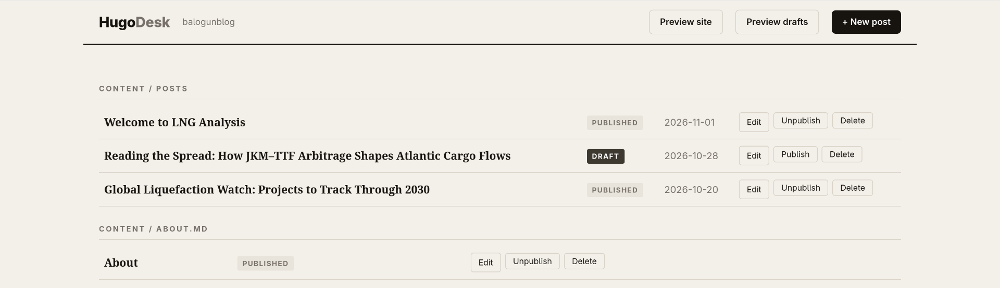

# HugoDesk

A portable local GUI editor for **any Hugo blog**. Launch it inside a Hugo site
root and get a clean, magazine-style web UI for writing posts, managing drafts,
and previewing the site — no configuration, no dependencies.

```
cd /path/to/your/hugo/site
hugodesk
→ HugoDesk  http://127.0.0.1:8765   (opens automatically)
```



## Why HugoDesk

- **Single binary, zero dependencies.** The UI, templates and CSS are embedded
  in the executable. Nothing is installed into your Hugo site, nothing is added
  to it, and no Go toolchain is needed at runtime.
- **Universal.** It reads standard Hugo `content/` markdown with YAML or TOML
  front matter — any theme, any layout, any Hugo config (hugo.toml,
  config.toml, hugo.yaml, config.yaml).
- **Conservative by design.** It only ever reads and writes files under your
  site's `content/` directory. Advanced/nested front matter it can't display is
  warned about and never silently dropped.
- **Local only.** The server binds to `127.0.0.1` — never exposed to the network.

## Features

| Feature | Description |
|---|---|
| Dashboard | All content files grouped by section, with title, date and DRAFT/PUBLISHED badges |
| Create posts | Section picker, title, date, categories, tags, summary and Markdown body; slug auto-derived from the title (collision-safe) |
| Editing | Two-pane editor: form on the left, **live Markdown preview** on the right |
| Live preview | Renders headings, bold/italic, links, lists, blockquotes, fenced code, GFM tables and images |
| Image upload | Pick, drag-and-drop or paste an image in the editor; it's saved to `static/images/` (collision-safe name) and inserted as Markdown at the cursor |
| Draft control | Publish / Unpublish any post with one click |
| Delete | With confirmation dialog |
| Site preview | Spawns `hugo server` on a free port and opens it in a new tab: **Preview site** (published content only) and **Preview drafts** (includes `draft: true`) |
| Safe front matter | Unknown simple keys (e.g. `author`, `customkey`) are preserved verbatim on save |

## Installation

### Option A — prebuilt binary

Copy `hugodesk` anywhere on your `PATH`:

```
cp hugodesk ~/.local/bin/       # or /usr/local/bin
hugodesk --help
```

### Option B — build from source

Requires Go 1.22+ (no module dependencies to download):

```
git clone <this-repo> hugodesk          # or just keep the folder
cd hugodesk
go build -o hugodesk .
cp hugodesk ~/.local/bin/
```

### Verify

```
cd ~/your-hugo-site
hugodesk -port 9000
```

## Usage

```
cd /path/to/any/hugo/site   # must contain content/
hugodesk [-port 8765]
```

- The UI opens at `http://127.0.0.1:8765` (browser opens automatically).
- Use **+ New post** to write, **Edit** to change, **Publish/Unpublish** to
  toggle `draft`.
- Saving never renames files: the post you are editing stays at its path.
- Add a post to the site: set `draft: false` (uncheck Draft) — the real Hugo
  site picks it up on the next build; nothing needs to be done by HugoDesk.
- **Preview site** always reflects *published* content only; use **Preview
  drafts** when you also want to see draft posts. Switching modes restarts the
  embedded preview server on a new free port (4321–4360).
- Click **Stop preview** to shut the embedded preview server down.

### Front matter handling

HugoDesk writes YAML front matter (valid for every Hugo site):

```yaml
---
title: "My new post"
date: 2026-11-03
categories: ["Analysis"]
tags: ["lng", "markets"]
summary: "One-line summary shown in lists."
draft: true
---
```

- Files in TOML (`+++`) front matter are read fine and rewritten as YAML.
- Simple scalar keys you added yourself are kept as-is.
- If front matter contains nested structures (tables, multi-line values),
  the editor shows a warning; those files are safe to open, and complex keys
  are not modified unless the warning panel says otherwise. Delete/edit such
  files with your normal editor if in doubt.

## FAQ / Troubleshooting

**After I unpublish, the post still shows in preview — do I need to rebuild?**
No. `hugo server` watches files and rebuilds automatically. "Preview site"
never shows drafts; unpublishing (checking "Draft") removes the post from that
view instantly. To see drafts, use **Preview drafts**.

**Port already in use?**
Use another port: `hugodesk -port 9001`.

**"Hugo binary not found in PATH"**
Editing works without Hugo, but site preview needs the `hugo` executable.
Install Hugo first.

**Syntax errors after hand-editing front matter?**
HugoDesk skips lines it can't parse and keeps them out of your way rather than
crashing; it will show a warning top bar once saved through the editor.

**Where are my posts?**
HugoDesk manages everything under `content/*.md` — exactly what Hugo builds.

## Privacy & scope

- Listens on loopback (`127.0.0.1`) only.
- Validates all paths against your site's `content/` directory.
- Does not track, phone home, or write anywhere outside the site you point it at.

## License

MIT — do whatever you like, attribution appreciated.
